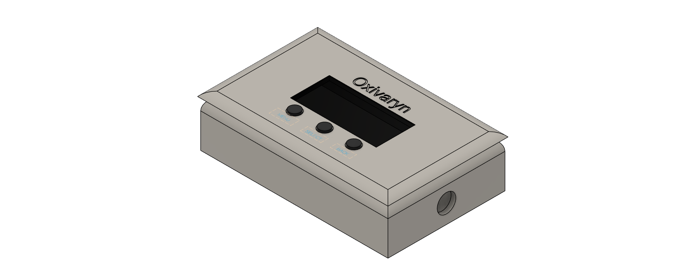
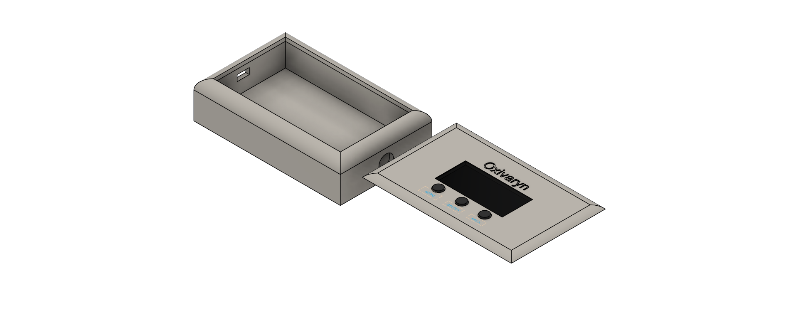

# Oxivaryn
### A Python-Based Oxygen Sensor Performance Monitoring Research Prototype

Oxivaryn is an educational biomedical engineering project exploring the performance deterioration of oxygen sensors used in medical ventilators that is designed by Matheesha Bandara.

The project was inspired by observations made during a biomedical equipment internship, where oxygen sensor lifespan, measurement reliability, and maintenance requirements were identified as important engineering considerations.

Oxivaryn uses simulated oxygen measurements to investigate measurement accuracy, drift, and stability. It includes a Python analysis engine, an interactive Streamlit dashboard, downloadable PDF reports, and a conceptual enclosure designed in Autodesk Fusion 360.

> **Disclaimer:** Oxivaryn is an educational research prototype. It has not been validated using physical oxygen sensors or clinical equipment and must not be used for medical decisions, ventilator calibration, or patient monitoring.

## Project Objectives

- Simulate healthy, drifting, and degraded oxygen sensor measurement patterns.
- Quantify measurement error, bias, drift, and random variability.
- Visualize sensor performance through an interactive dashboard.
- Analyze appropriately formatted external CSV datasets.
- Generate downloadable PDF performance reports.
- Validate the mathematical analysis engine using known synthetic inputs.
- Develop a conceptual enclosure using CAD.

## System Architecture

```text
Simulated Data / Uploaded CSV
             |
             v
    Input Validation
             |
             v
  Measurement Analysis Engine
             |
             v
   Streamlit Visualization
             |
             v
     PDF Report Generation
```

## Performance Metrics

Oxivaryn calculates five metrics:

| Metric | Description |
|---|---|
| Mean Absolute Error (MAE) | Average absolute difference between measured and reference oxygen concentrations |
| Mean Bias | Average signed measurement error |
| Maximum Absolute Error | Largest absolute measurement deviation |
| Drift Slope | Linear change in measurement error per unit of the supplied time axis |
| Detrended Stability | Sample standard deviation of measurement-error residuals after removing a fitted linear trend |

Oxygen measurement differences are expressed in percentage points (pp).

## Simulated Sensor Scenarios

Three synthetic measurement patterns are included:

1. **Healthy:** Small random measurement variations around the reference.
2. **Drifting:** Progressive measurement bias over successive observations.
3. **Degraded:** Larger measurement deviations and increased random variability.

The simulated scenarios use a nominal reference oxygen concentration of 40%.

### Example Simulation Results

| Scenario | MAE (pp) | Stability (pp) | Drift (pp/measurement) |
|---|---:|---:|---:|
| Healthy | 0.145 | 0.181 | +0.0003 |
| Drifting | 1.998 | 0.191 | -0.0404 |
| Degraded | 5.028 | 0.864 | -0.1037 |

These results were generated from synthetic data and do not represent measured performance of actual ventilator oxygen sensors.

## Interactive Dashboard

The Streamlit dashboard supports:

- Selection of simulated sensor scenarios.
- Uploading compatible CSV datasets.
- Visualization of oxygen measurements and measurement error.
- Calculation of five performance metrics.
- Experimental classification of simulated scenarios.
- Downloadable PDF performance reports.

Uploaded CSV measurements receive descriptive analysis only. The experimental classification thresholds are not clinically validated.

### CSV Format

Uploaded files must contain the following columns:

```csv
Time,Reference_Oxygen,Sensor_Reading
0,40.0,40.1
1,40.0,39.9
2,40.0,39.8
```

Time values must be numeric, unique, and strictly increasing. Oxygen concentrations must be between 0 and 100%.

## Software Validation

The shared Python measurement analysis engine was tested using 11 automated checks covering:

- Perfect measurements.
- Constant measurement offset.
- Linear drift.
- MAE, bias, maximum error, drift slope, and detrended stability.
- Rejection of duplicate time values.

**Validation result: 11/11 checks passed.**

These checks verify selected mathematical calculations and input validation. They do not establish clinical accuracy or complete software verification.

## Conceptual CAD Enclosure

A conceptual portable instrument enclosure was designed using Autodesk Fusion 360.

Features include:

- Separate upper lid and lower housing.
- Display opening.
- Three control buttons.
- Sensor interface placeholder.
- USB port placeholder.
- Oxivaryn branding.
- Exploded assembly visualization.

The CAD design is conceptual and does not include verified electronics, fastening systems, or sensor-interface specifications.

### CAD Design Gallery

#### Assembled Enclosure



*Figure 1. Conceptual Oxivaryn enclosure showing the display opening, three control buttons, and instrument housing.*

#### Exploded Enclosure



*Figure 2. Exploded isometric view showing the detachable top panel and hollow lower enclosure.*

### Fusion 360 Design Files

The original CAD models are available in the `cad/` directory:

- [Assembled Enclosure](cad/Oxivaryn_Enclosure.f3d)
- [Exploded Enclosure](cad/Oxivaryn_Exploded_View.f3d)

These designs illustrate the proposed physical form of Oxivaryn. They are conceptual models rather than manufacturing-ready hardware.

## Installation

### Requirements

- Python 3.13 or a compatible Python version.
- Dependencies listed in `requirements.txt`.

### Setup

Clone the repository:

```bash
git clone https://github.com/YOUR_USERNAME/Oxivaryn.git
cd Oxivaryn
```

Install dependencies:

```bash
python -m pip install -r requirements.txt
```

Launch the Streamlit dashboard:

```bash
python -m streamlit run dashboard/app.py
```

## Run the Analysis Script

```bash
python src/measurement_analysis.py
```

## Run Automated Validation

```bash
python src/validate_oxivaryn.py
```

The validation script should report:

```text
VALIDATION RESULT: 11/11 PASSED
All analysis engine tests passed.
```

## Limitations

- No physical oxygen sensor measurements have been collected.
- No direct connection to a medical ventilator has been implemented.
- Simulated performance patterns are simplified representations.
- Experimental classification thresholds are not manufacturer-approved.
- Drift slope depends on the units of the supplied time axis.
- The CAD enclosure is not manufacturing-ready.
- Software validation currently covers selected analytical calculations rather than all application functions.

## Future Development

Potential future work includes:

- Controlled bench testing with appropriate calibrated reference instruments.
- Expanded simulated failure scenarios.
- Additional automated tests and validation datasets.
- Improved statistical analysis and uncertainty estimation.
- Hardware-interface research and enclosure refinement.
- Deployment of the Streamlit application for educational demonstration.

## Project Status

**Educational software prototype with conceptual CAD design.**

Core analysis, visualization, PDF reporting, and selected mathematical validation checks have been completed.

### Live Application

[Launch the Oxivaryn Dashboard](https://oxivaryn.streamlit.app)

Explore simulated oxygen sensor performance, visualize measurement trends, and generate downloadable PDF reports.

**Disclaimer:** Oxivaryn is an educational research prototype. It is not a clinically validated medical device and must not be used for patient care or ventilator monitoring.